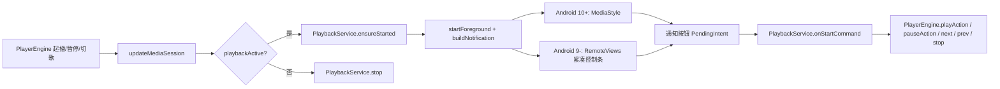

# 更新说明：播放通知与媒体控制（2026-10-18）

> 对应提交：`ac9b3a8 播放通知：补齐媒体控件与封面，兼容 Android 9 手表`
>
> 目标读者：需要把本次功能合并到新版上游代码的维护者。
>
> 本文同时说明「为什么这么做」和「具体改了哪些代码」，最后一节给出移植清单与测试清单。

---

## 1. 背景与目标

本次要解决的问题：

1. 播放音乐时，通知栏没有可用的播放控制组件。
2. Android 9 手表（ColorOS Watch / 定制 ROM）的通知中心会把媒体通知渲染成「封面 + 歌名」的大卡片，并**整组丢弃 `Notification.Action`**，导致看不到上一首/播放暂停/下一首。
3. 通知没有封面；系统媒体面板、蓝牙 AVRCP、锁屏也没有封面。
4. 冷启动存在竞态：如果 `ensurePlayer()` 先于 `warmUp()` 同步补建播放器，旧代码会释放后台构建的播放器，却**不再初始化 MediaSession**，于是 `Notification.MediaStyle` 拿不到 token，通知退化成普通通知，系统媒体面板也全空。

目标行为：

- Android 10+ / 手机：标准 `MediaStyle` 媒体通知，封面、歌名、歌手、专辑，三个控制键，点击回到 App。
- Android 9 及以下：自定义 `RemoteViews` 紧凑控制条，封面、歌名/歌手、「上一首 / 播放暂停 / 下一首 / 关闭」。
- 通知、锁屏、蓝牙线控、手表「正在播放」卡片共用同一个 `MediaSession`。
- 不改变原有「暂停即撤前台服务」的保活策略。

---

## 2. 最终效果

| 设备/系统 | 通知样式 | 控制键 |
|---|---|---|
| Android 10+ 手机/手表 | `Notification.MediaStyle`，系统媒体模板 | 上一首、播放暂停、下一首 |
| Android 9 及以下 | 自定义 `RemoteViews` 紧凑行（`notification_media_compact.xml`） | 上一首、播放暂停、下一首、关闭 X |
| 通知点击 | 回到 `MainActivity` | — |
| 关闭 X | 暂停播放并撤掉通知，保留队列与当前歌 | — |

通知只在**播放/缓冲期间**存在；暂停后前台服务按原设计撤掉，通知随之消失（见「已知限制」）。

---

## 3. 调用链



关键点：

- `PlayerEngine.updateMediaSession()` 是唯一的总入口：每次状态/歌曲变化都会先调用 `syncForeground()`，再回写播放状态与元数据。
- `syncForeground()` 根据 `playbackActive` 拉起或停止 `PlaybackService`。
- 通知按钮通过 `PendingIntent.getService` 发 `ACTION_*`，由 `PlaybackService.onStartCommand` 翻译回 `PlayerEngine` 的业务方法，**不直接操作 ExoPlayer**（队列、播放模式、一起听协调都在 `PlayerEngine` 里）。

---

## 4. 实现原理

### 4.1 前台服务与通知生命周期

`PlaybackService` 是 `foregroundServiceType="mediaPlayback"` 的前台服务，负责两件事：

1. 把进程提升到前台服务优先级，避免熄屏/后台播放被系统回收。
2. 承载媒体通知。

```kotlin
fun ensureStarted(ctx: Context) {
    instance?.let { s ->
        if (PlayerEngine.playbackActive) s.startForeground(NOTIF_ID, s.buildNotification())
        return
    }
    runCatching {
        ctx.startForegroundService(Intent(ctx, PlaybackService::class.java).setAction(ACTION_START))
    }
}
```

- 服务已在运行：直接 `startForeground` 原地刷新通知，不经过 `startService`，因此后台自动切歌也能更新通知。
- 服务未运行：`startForegroundService(ACTION_START)` 拉起；`onStartCommand` 必须在 5 秒内调用 `startForeground`，否则系统会抛 `RemoteServiceException`。代码里对「拉起后意图又翻转」的时序做了补一次 `startForeground` 再撤回的处理。

暂停/空闲时 `PlayerEngine.syncForeground()` 调用 `PlaybackService.stop()`，前台服务与通知一起撤掉。

### 4.2 MediaSession 双通道

项目里有两条会话，读同一个 `ExoPlayer`，写同一套 `PlayerEngine` 业务方法：

1. **平台 `android.media.session.MediaSession`**（`PlayerEngine.initMediaSession()`）：
   - 供 AVRCP 蓝牙按键、锁屏、部分系统媒体面板使用。
   - `Notification.MediaStyle.setMediaSession(token)` 关联的就是它。
2. **Media3 `MediaSessionService`**（`MusicSessionService`）：
   - 供 ColorOS Watch 表盘音乐卡片 / 「正在播放」页扫描 `androidx.media3.session.MediaSessionService` 发现。
   - 其 `onUpdateNotification` 被故意覆盖为空，避免和 `PlaybackService` 出现两条媒体通知。

本次给平台会话补了三项：

```kotlin
ms.setFlags(
    MediaSession.FLAG_HANDLES_MEDIA_BUTTONS or
        MediaSession.FLAG_HANDLES_TRANSPORT_CONTROLS
)
ms.setSessionActivity(openAppPendingIntent)
```

- `FLAG_HANDLES_MEDIA_BUTTONS / FLAG_HANDLES_TRANSPORT_CONTROLS`：让框架把媒体键路由到本会话。
- `setSessionActivity`：点击锁屏/系统媒体卡片回到 App。

### 4.3 冷启动竞态修复（关键）

`PlayerEngine` 的初始化有两条路径：

- `warmUp()`：首帧后在后台线程构建 `ExoPlayer`，回主线程赋值并建会话。
- `ensurePlayer()`：预热未完成时，在主线程同步补建播放器（冷启动 300ms 内点歌、系统媒体服务提前 bind 都会走这里）。

旧代码把 `initMediaSession()` 只写在 `warmUp()` 的 `if (player == null)` 分支里：

```kotlin
if (player == null) {
    configPlayer(p)
    player = p
    initMediaSession()      // 只有这条路径建会话
} else {
    p.release()             // ensurePlayer 已同步补建：释放后台播放器，但没建会话
}
```

如果 `ensurePlayer()` 先执行，后台构建完成后会走 `else` 分支，`MediaSession` 永远不创建。后果：

- `PlayerEngine.mediaSessionToken == null`
- `Notification.MediaStyle` 不生效（或通知没有媒体模板）
- 蓝牙线控、系统媒体面板、锁屏封面全部失效

修复方式：抽出幂等的 `ensureMediaSession()`，两条路径都调用：

```kotlin
private fun ensureMediaSession() {
    if (mediaSession == null) initMediaSession()
}
```

`ensurePlayer()` 同步补建播放器后立即调用；`warmUp()` 在 `if/else` 之后统一调用。

### 4.4 Android 9 兼容：为什么用 RemoteViews

真机（Android 9 手表）验证结果：

- 普通通知：显示为「大封面卡片」，`Notification.Action` 不显示。
- `MediaStyle` 通知：同样显示为大卡片，`setShowActionsInCompactView(0,1,2)` 的三个 action 被整组丢弃。
- 系统顶部的媒体控制条（带「词」「X」）是 OEM 私有能力，第三方 App 无法直接插入。

因此对 `Build.VERSION.SDK_INT <= 28` 使用自定义 `RemoteViews`：

```kotlin
if (legacyCompact) {
    val rv = RemoteViews(packageName, R.layout.notification_media_compact)
    rv.setTextViewText(R.id.notif_title, song?.title ?: "NetMusicLite")
    rv.setTextViewText(R.id.notif_artist, artistAndAlbum)
    rv.setImageViewBitmap(R.id.notif_cover, art)
    rv.setOnClickPendingIntent(R.id.notif_prev, cmd(ACTION_PREV))
    rv.setOnClickPendingIntent(R.id.notif_toggle, cmd(if (playing) ACTION_PAUSE else ACTION_PLAY))
    rv.setOnClickPendingIntent(R.id.notif_next, cmd(ACTION_NEXT))
    rv.setOnClickPendingIntent(R.id.notif_close, cmd(ACTION_STOP))
    rv.setOnClickPendingIntent(R.id.notif_root, contentPi)
    builder.setCustomContentView(rv)
    builder.setCustomBigContentView(rv)
}
```

配套处理：

- `legacyCompact` 设备使用独立渠道 `playback_watch`，重要性 `IMPORTANCE_DEFAULT`（部分通知中心会折叠 `IMPORTANCE_LOW`）。
- `setOngoing(!legacyCompact)`：部分通知中心不把 ongoing 通知放进「消息」列表。
- `ACTION_STOP`：暂停 + `stopForeground(REMOVE)` + `stopSelf()`，对应紧凑条右侧的 X。

> 不要用 `FEATURE_WATCH` 判断这块设备：实测该手表既没有 `FEATURE_WATCH`，`uiMode` 也不是 `WATCH`。最终按 `SDK_INT <= 28` 走兼容分支，最稳。

### 4.5 通知渠道策略

| 渠道 ID | 使用场景 | 重要性 |
|---|---|---|
| `playback` | Android 10+ / 普通设备 | `IMPORTANCE_LOW` |
| `playback_watch` | Android 9 及以下、手表 | `IMPORTANCE_DEFAULT` |

注意：Android 的渠道属性**只在首次创建时生效**。如果后续要改声音/重要性/锁屏可见性，必须换新的渠道 ID，不能依赖修改已有渠道。

两个渠道都设置：

- `setShowBadge(false)`
- `setSound(null, null)`
- `enableVibration(false)`
- `lockscreenVisibility = VISIBILITY_PUBLIC`

### 4.6 封面异步加载

通知构建在 `onStartCommand` / `startForeground` 的主线程路径上，不能在这里做网络/解码。做法：

1. `notificationArt(song)` 先查静态缓存（`artKey` / `artBitmap`）。
2. 未命中则用 Coil `ImageLoader.enqueue` 异步加载：
   - `allowHardware(false)`：通知大图必须是软件 Bitmap。
   - `size(512)`：通知大图足够，省内存。
3. 加载成功后回到主线程，写入缓存，并调用 `startForeground(NOTIF_ID, buildNotification())` 原地刷新通知。
4. 失败也记录 `artFailedKey`，避免每次播放/暂停重复请求同一个坏链接。
5. 缓存放在 companion（静态），因为暂停会销毁服务，恢复时新实例可以复用封面，避免闪白。

封面来源统一走 `PlayerEngine.artworkModelFor(song)`，内部复用界面层 `songCoverModel(song)`，保证通知封面与 App 内显示的是同一张（本地文件 / 已下载封面 / 网络 URL）。

### 4.7 通知动作与关闭

三个标准 action：

```kotlin
addAction(Icon.createWithResource(this, R.drawable.ic_notif_prev), "上一首", cmd(ACTION_PREV))
addAction(Icon.createWithResource(this, if (playing) R.drawable.ic_notif_pause else R.drawable.ic_notif_play),
    if (playing) "暂停" else "播放", cmd(if (playing) ACTION_PAUSE else ACTION_PLAY))
addAction(Icon.createWithResource(this, R.drawable.ic_notif_next), "下一首", cmd(ACTION_NEXT))
```

`onStartCommand` 映射：

```kotlin
ACTION_PLAY -> PlayerEngine.playAction()
ACTION_PAUSE -> PlayerEngine.pauseAction()
ACTION_NEXT -> PlayerEngine.next()
ACTION_PREV -> PlayerEngine.prev()
ACTION_STOP -> { PlayerEngine.pauseAction(); stopForeground(STOP_FOREGROUND_REMOVE); stopSelf() }
```

### 4.8 元数据与系统媒体面板

`PlayerEngine.updateMediaSession()` 除了标题/歌手/专辑/时长，还写入封面 URI：

```kotlin
coverUriFor(s)?.let { uri ->
    builder.putString(MediaMetadata.METADATA_KEY_ALBUM_ART_URI, uri.toString())
    builder.putString(MediaMetadata.METADATA_KEY_ART_URI, uri.toString())
}
```

- 只上报 URI，不上报 Bitmap，避免每次状态刷新都往 Binder 里塞图。
- 系统侧按需加载；失败只显示占位图，不影响播放。
- 无当前歌曲时用空 `MediaMetadata` 清掉旧数据，避免系统面板残留上一首。

---

## 5. 改动文件清单

| 文件 | 类型 | 作用 |
|---|---|---|
| `app/src/main/java/com/netmusiclite/data/PlaybackService.kt` | 修改 | 媒体通知、前台服务、封面加载、Android 9 RemoteViews 兼容 |
| `app/src/main/java/com/netmusiclite/data/PlayerEngine.kt` | 修改 | MediaSession 初始化竞态修复、flags/sessionActivity/封面元数据、`artworkModelFor` |
| `app/src/main/res/layout/notification_media_compact.xml` | 新增 | Android 9 及以下紧凑控制条布局 |
| `app/src/main/res/drawable/ic_notif_close.xml` | 新增 | 紧凑条关闭 X 图标 |
| `README.md` | 修改 | 功能列表补充「通知与媒体控制」 |

`app/build.gradle.kts`、`AndroidManifest.xml` **不需要改动**（前台服务、`FOREGROUND_SERVICE_MEDIA_PLAYBACK`、`POST_NOTIFICATIONS` 原工程已有）。

---

## 6. 完整代码

### 6.1 `app/src/main/java/com/netmusiclite/data/PlaybackService.kt`

```kotlin
package com.netmusiclite.data

import android.app.Notification
import android.app.NotificationChannel
import android.app.NotificationManager
import android.app.PendingIntent
import android.app.Service
import android.content.Context
import android.content.Intent
import android.content.pm.PackageManager
import android.content.res.Configuration
import android.graphics.Bitmap
import android.graphics.drawable.BitmapDrawable
import android.graphics.drawable.Icon
import android.os.Build
import android.os.Handler
import android.os.IBinder
import android.os.Looper
import android.widget.RemoteViews
import coil.ImageLoader
import coil.request.ImageRequest
import com.netmusiclite.MainActivity
import com.netmusiclite.R

/**
 * 播放保活前台服务（foregroundServiceType=mediaPlayback）。
 *
 * ★「播放中被杀后台」根因（2026-09-26）：全应用此前没有任何前台服务 —— ExoPlayer 跑在
 *   Activity 进程里，退到桌面/熄屏后进程被降为缓存进程，系统内存紧张时直接回收，播放中断。
 *   修法：PlayerEngine 在有播放意图（播放中/缓冲中）时经 [ensureStarted] 拉起本服务
 *   startForeground，把整个进程提升到前台服务优先级（ExoPlayer 与本服务同进程，一并受保护）；
 *   暂停/空闲即撤 —— 播放进度/队列随 player_state.json 持续落盘，进程被杀重进可续播。
 *   MediaSession 仍由 PlayerEngine 持有（手表表盘媒体控件/耳机线控不变），
 *   通知栏按键经 onStartCommand 直接驱动 PlayerEngine。Android 10+ 用 MediaStyle
 *   关联同一会话；Android 9 及以下改用自定义 RemoteViews 紧凑控制条（部分手表
 *   通知中心不渲染 MediaStyle 的 action）。
 */
class PlaybackService : Service() {

    /** 通知封面专用解码器：关闭硬件位图（Notification 大图需软件 Bitmap） */
    private val artLoader by lazy {
        ImageLoader.Builder(applicationContext).allowHardware(false).build()
    }
    private val artHandler by lazy { Handler(Looper.getMainLooper()) }

    /** 手表判定：Wear OS 与部分国产手表不声明 FEATURE_WATCH，再看 uiMode 与小屏宽度 */
    private val isWatchDevice: Boolean
        get() = packageManager.hasSystemFeature(PackageManager.FEATURE_WATCH) ||
            (resources.configuration.uiMode and Configuration.UI_MODE_TYPE_MASK) ==
            Configuration.UI_MODE_TYPE_WATCH ||
            resources.configuration.smallestScreenWidthDp <= 240

    /**
     * Android 9 及以下的兼容通道：这类设备多为老手表/定制 ROM，
     * 通知中心会把 MediaStyle 渲染成「只有封面+歌名的媒体卡」，并丢弃 action 按钮。
     * 这类设备改用自定义 RemoteViews 紧凑控制条（封面 + 歌名 + 切歌/暂停/关闭）。
     */
    private val legacyCompact: Boolean
        get() = Build.VERSION.SDK_INT <= 28

    /**
     * 手表单独用一条渠道，重要性 DEFAULT：
     * 部分手表通知中心会把 IMPORTANCE_LOW 的渠道折叠掉，媒体通知就完全看不见。
     */
    private val channelId: String
        get() = if (legacyCompact || isWatchDevice) CHANNEL_ID_WATCH else CHANNEL_ID

    override fun onBind(intent: Intent?): IBinder? = null

    override fun onCreate() {
        super.onCreate()
        instance = this
    }

    override fun onDestroy() {
        instance = null
        super.onDestroy()
    }

    override fun onStartCommand(intent: Intent?, flags: Int, startId: Int): Int {
        when (intent?.action) {
            ACTION_PLAY -> PlayerEngine.playAction()
            ACTION_PAUSE -> PlayerEngine.pauseAction()
            ACTION_NEXT -> PlayerEngine.next()
            ACTION_PREV -> PlayerEngine.prev()
            ACTION_STOP -> {
                // 通知右上角 X：暂停并撤掉通知（不销毁队列/当前歌，下次播放可续）
                PlayerEngine.pauseAction()
                stopForeground(STOP_FOREGROUND_REMOVE)
                stopSelf()
                return START_NOT_STICKY
            }
        }
        if (PlayerEngine.playbackActive) {
            startForeground(NOTIF_ID, buildNotification())
        } else {
            // ★ 2026-09-30 修「点播放后马上暂停 → 进程被杀」：
            //   ensureStarted() 判定播放意图成立时才调 startForegroundService()，但意图可能在
            //   本回调执行前就翻转（用户立刻暂停 / 起播失败撤销 fgWanted / 队列被替换）——
            //   旧版这时直接 stopForeground+stopSelf，从未调用 startForeground()，系统在 5s 后
            //   抛 RemoteServiceException: "Context.startForegroundService() did not then call
            //   Service.startForeground()" 杀掉整个进程（真机实测必崩，crash buffer 可查）。
            //   契约只对 startForegroundService 拉起的这次启动（本类走 ACTION_START）生效：
            //   先补一次 startForeground 满足契约，再立刻撤回（通知一闪即消，无残留）。
            if (intent?.action == ACTION_START) {
                startForeground(NOTIF_ID, buildNotification())
            }
            stopForeground(STOP_FOREGROUND_REMOVE)
            stopSelf()
        }
        return START_NOT_STICKY
    }

    private fun buildNotification(): Notification {
        val chId = channelId
        getSystemService(NotificationManager::class.java).let { nm ->
            if (nm.getNotificationChannel(chId) == null) {
                val importance = if (legacyCompact || isWatchDevice) {
                    // 手表/老设备：DEFAULT 才不会被部分通知中心折叠；声音/震动仍关闭
                    NotificationManager.IMPORTANCE_DEFAULT
                } else {
                    NotificationManager.IMPORTANCE_LOW
                }
                nm.createNotificationChannel(
                    NotificationChannel(chId, "正在播放", importance).apply {
                        description = "显示当前歌曲信息，并提供上一首 / 播放暂停 / 下一首控制"
                        setShowBadge(false)
                        // 媒体通知不该发声/震动：控制按键的反馈由播放器自己负责。
                        // 注意通道属性只在首次创建时生效，老安装升级后仍沿用原来的配置。
                        setSound(null, null)
                        enableVibration(false)
                        lockscreenVisibility = Notification.VISIBILITY_PUBLIC
                    },
                )
            }
        }
        val song = PlayerEngine.current
        val playing = PlayerEngine.isPlaying
        val contentPi = PendingIntent.getActivity(
            this, 0,
            Intent(this, MainActivity::class.java)
                .addFlags(Intent.FLAG_ACTIVITY_NEW_TASK or Intent.FLAG_ACTIVITY_SINGLE_TOP),
            PendingIntent.FLAG_IMMUTABLE or PendingIntent.FLAG_UPDATE_CURRENT,
        )
        fun cmd(action: String): PendingIntent = PendingIntent.getService(
            this, action.hashCode(),
            Intent(this, PlaybackService::class.java).setAction(action),
            PendingIntent.FLAG_IMMUTABLE or PendingIntent.FLAG_UPDATE_CURRENT,
        )
        val builder = Notification.Builder(this, chId)
            .setSmallIcon(R.drawable.ic_notif_w)
            .setContentTitle(song?.title ?: "NetMusicLite")
            .setContentText(song?.artist ?: "")
            .setContentIntent(contentPi)
            .setCategory(Notification.CATEGORY_TRANSPORT)
            .setVisibility(Notification.VISIBILITY_PUBLIC)
            .setOnlyAlertOnce(true)
            // 老设备上不锁常驻：部分通知中心会把 ongoing 通知排除在「消息」列表之外；
            // 新设备仍保持常驻，避免被误滑掉。
            .setOngoing(!legacyCompact)
            // 媒体通知不显示「几点发的」；时间戳对正在播放的卡片没有意义
            .setShowWhen(false)
            .addAction(Notification.Action.Builder(
                Icon.createWithResource(this, R.drawable.ic_notif_prev), "上一首", cmd(ACTION_PREV)).build())
            .addAction(Notification.Action.Builder(
                Icon.createWithResource(
                    this, if (playing) R.drawable.ic_notif_pause else R.drawable.ic_notif_play),
                if (playing) "暂停" else "播放",
                cmd(if (playing) ACTION_PAUSE else ACTION_PLAY),
            ).build())
            .addAction(Notification.Action.Builder(
                Icon.createWithResource(this, R.drawable.ic_notif_next), "下一首", cmd(ACTION_NEXT)).build())
        val art = song?.let { notificationArt(it) }
        if (song != null) {
            // 专辑名放 subText（展开态显示），小屏上不挤占歌手行
            if (song.album.isNotBlank()) builder.setSubText(song.album)
            // 封面大图：首次构建时通常还没解码完，先出文字版，图到了再原地刷新
            art?.let { builder.setLargeIcon(it) }
        }
        if (legacyCompact) {
            // ★ 紧凑控制条（2026-10-18）：
            //   部分 Android 9 手表/定制 ROM 的通知中心会把普通通知画成大卡片、且不渲染 action；
            //   唯一能自定义的就是 RemoteViews —— 自己画一行「封面 + 歌名/歌手 + 上一首/
            //   播放暂停/下一首/关闭」，点按由 PendingIntent 直接驱动播放服务。
            val rv = RemoteViews(packageName, R.layout.notification_media_compact)
            rv.setTextViewText(R.id.notif_title, song?.title ?: "NetMusicLite")
            rv.setTextViewText(
                R.id.notif_artist,
                listOfNotNull(
                    song?.artist?.takeIf { it.isNotBlank() },
                    song?.album?.takeIf { it.isNotBlank() },
                ).joinToString(" · "),
            )
            if (art != null) {
                rv.setImageViewBitmap(R.id.notif_cover, art)
            } else {
                rv.setImageViewResource(R.id.notif_cover, R.mipmap.ic_launcher)
            }
            rv.setImageViewResource(
                R.id.notif_toggle,
                if (playing) R.drawable.ic_notif_pause else R.drawable.ic_notif_play,
            )
            rv.setOnClickPendingIntent(R.id.notif_root, contentPi)
            rv.setOnClickPendingIntent(R.id.notif_prev, cmd(ACTION_PREV))
            rv.setOnClickPendingIntent(R.id.notif_toggle, cmd(if (playing) ACTION_PAUSE else ACTION_PLAY))
            rv.setOnClickPendingIntent(R.id.notif_next, cmd(ACTION_NEXT))
            rv.setOnClickPendingIntent(R.id.notif_close, cmd(ACTION_STOP))
            builder.setCustomContentView(rv)
            builder.setCustomBigContentView(rv)
        } else {
            PlayerEngine.mediaSessionToken?.let { token ->
                builder.setStyle(
                    Notification.MediaStyle().setMediaSession(token).setShowActionsInCompactView(0, 1, 2),
                )
            }
        }
        if (Build.VERSION.SDK_INT >= 31) {
            builder.setForegroundServiceBehavior(Notification.FOREGROUND_SERVICE_IMMEDIATE)
        }
        return builder.build()
    }

    /**
     * 通知封面：同步取缓存，未命中就交给 Coil 异步解码，完成后原地刷新通知。
     *
     * 为什么不在主线程同步解码：封面可达数百 KB，网络图还要等下载/解码，通知构建是主线程路径
     * （onStartCommand / startForeground），在这里做 I/O 会直接卡住表盘滑动。
     * 为什么用静态缓存：暂停会销毁服务，恢复时新实例重新建通知 —— 缓存留在 companion
     * 里可避免每次续播都闪一下无封面。
     */
    private fun notificationArt(song: Song): Bitmap? {
        val key = "${song.id}:${song.coverUrl.orEmpty()}"
        if (key == artKey) return artBitmap
        if (key == artLoadingKey || key == artFailedKey) return null
        val model = PlayerEngine.artworkModelFor(song) ?: return null
        artLoadingKey = key
        val request = ImageRequest.Builder(applicationContext)
            .data(model)
            .size(512)            // 通知大图上限约 64dp@xxxhdpi，512 足够且省内存
            .allowHardware(false) // Notification 大图必须是软件位图
            .listener(
                onSuccess = { _, result ->
                    val bitmap = (result.drawable as? BitmapDrawable)?.bitmap
                    artHandler.post {
                        artLoadingKey = null
                        if (bitmap != null) {
                            artKey = key
                            artBitmap = bitmap
                            // 图到时若已切歌/已暂停，就不要把旧图刷到新状态上
                            if (PlayerEngine.current?.id == song.id && PlayerEngine.playbackActive) {
                                instance?.let { runCatching { it.startForeground(NOTIF_ID, it.buildNotification()) } }
                            }
                        } else {
                            artFailedKey = key
                        }
                    }
                },
                onError = { _, _ ->
                    artHandler.post {
                        artLoadingKey = null
                        // 失败也记下来，避免每次播放/暂停都重新发起同一个坏链接
                        artFailedKey = key
                    }
                },
            )
            .build()
        artLoader.enqueue(request)
        return null
    }

    companion object {
        private const val CHANNEL_ID = "playback"
        private const val CHANNEL_ID_WATCH = "playback_watch"
        private const val NOTIF_ID = 42
        const val ACTION_START = "com.netmusiclite.playback.START"
        const val ACTION_PLAY = "com.netmusiclite.playback.PLAY"
        const val ACTION_PAUSE = "com.netmusiclite.playback.PAUSE"
        const val ACTION_NEXT = "com.netmusiclite.playback.NEXT"
        const val ACTION_PREV = "com.netmusiclite.playback.PREV"
        const val ACTION_STOP = "com.netmusiclite.playback.STOP"

        /** 运行中服务实例（同进程直引用：通知原地刷新用） */
        @Volatile
        private var instance: PlaybackService? = null

        // 封面缓存：键 = 歌曲 id + 封面地址。服务暂停会被销毁，恢复时新实例靠这里避免闪白。
        @Volatile private var artKey: String? = null
        @Volatile private var artBitmap: Bitmap? = null
        @Volatile private var artLoadingKey: String? = null
        @Volatile private var artFailedKey: String? = null

        /**
         * PlayerEngine 在播放意图出现/歌曲切换时调用（主线程）。
         * 服务已运行：同进程直调 startForeground 原地刷新通知 —— 不经 start 系调用，
         * 后台自动切歌的路径也放行（31+ 的后台 FGS 启动限制只拦「启动」，不拦「已运行」）。
         * 未运行：startForegroundService 拉起（正常都在用户前台操作时发生）；极端时序
         * （蓝牙耳机从后台唤起播放）可能被系统拒绝，捕获后仅本次失去保护，不影响出声。
         */
        fun ensureStarted(ctx: Context) {
            instance?.let { s ->
                if (PlayerEngine.playbackActive) s.startForeground(NOTIF_ID, s.buildNotification())
                return
            }
            runCatching {
                ctx.startForegroundService(Intent(ctx, PlaybackService::class.java).setAction(ACTION_START))
            }
        }

        /** 暂停/空闲即撤：stopService 对运行中前台服务无后台限制；未运行时为无害 no-op */
        fun stop(ctx: Context) {
            runCatching { ctx.stopService(Intent(ctx, PlaybackService::class.java)) }
        }
    }
}
```

### 6.2 `app/src/main/res/layout/notification_media_compact.xml`

```xml
<?xml version="1.0" encoding="utf-8"?>
<LinearLayout xmlns:android="http://schemas.android.com/apk/res/android"
    android:id="@+id/notif_root"
    android:layout_width="match_parent"
    android:layout_height="wrap_content"
    android:minHeight="64dp"
    android:orientation="horizontal"
    android:gravity="center_vertical"
    android:paddingStart="8dp"
    android:paddingEnd="2dp"
    android:paddingTop="6dp"
    android:paddingBottom="6dp"
    android:background="#E6101010">

    <ImageView
        android:id="@+id/notif_cover"
        android:layout_width="52dp"
        android:layout_height="52dp"
        android:scaleType="centerCrop"
        android:contentDescription="@null" />

    <LinearLayout
        android:layout_width="0dp"
        android:layout_height="wrap_content"
        android:layout_weight="1"
        android:orientation="vertical"
        android:paddingStart="10dp"
        android:paddingEnd="4dp">

        <TextView
            android:id="@+id/notif_title"
            android:layout_width="match_parent"
            android:layout_height="wrap_content"
            android:singleLine="true"
            android:ellipsize="end"
            android:textSize="14sp"
            android:textStyle="bold"
            android:textColor="#FFFFFFFF" />

        <TextView
            android:id="@+id/notif_artist"
            android:layout_width="match_parent"
            android:layout_height="wrap_content"
            android:singleLine="true"
            android:ellipsize="end"
            android:textSize="11sp"
            android:textColor="#B3FFFFFF" />
    </LinearLayout>

    <ImageButton
        android:id="@+id/notif_prev"
        android:layout_width="38dp"
        android:layout_height="38dp"
        android:padding="7dp"
        android:background="@android:color/transparent"
        android:scaleType="centerInside"
        android:src="@drawable/ic_notif_prev"
        android:contentDescription="上一首" />

    <ImageButton
        android:id="@+id/notif_toggle"
        android:layout_width="38dp"
        android:layout_height="38dp"
        android:padding="7dp"
        android:background="@android:color/transparent"
        android:scaleType="centerInside"
        android:src="@drawable/ic_notif_pause"
        android:contentDescription="播放暂停" />

    <ImageButton
        android:id="@+id/notif_next"
        android:layout_width="38dp"
        android:layout_height="38dp"
        android:padding="7dp"
        android:background="@android:color/transparent"
        android:scaleType="centerInside"
        android:src="@drawable/ic_notif_next"
        android:contentDescription="下一首" />

    <ImageButton
        android:id="@+id/notif_close"
        android:layout_width="34dp"
        android:layout_height="34dp"
        android:padding="8dp"
        android:background="@android:color/transparent"
        android:scaleType="centerInside"
        android:src="@drawable/ic_notif_close"
        android:contentDescription="关闭" />
</LinearLayout>
```

### 6.3 `app/src/main/res/drawable/ic_notif_close.xml`

```xml
<?xml version="1.0" encoding="utf-8"?>
<!-- 通知关闭键：细 X 描边，与媒体通知其它单色图标一致 -->
<vector xmlns:android="http://schemas.android.com/apk/res/android"
    android:width="24dp"
    android:height="24dp"
    android:viewportWidth="24"
    android:viewportHeight="24">
    <path
        android:pathData="M7,7 L17,17 M17,7 L7,17"
        android:strokeColor="#FFFFFFFF"
        android:strokeWidth="2"
        android:strokeLineCap="round" />
</vector>
```

### 6.4 `PlayerEngine.kt` 改动（diff）

```diff
diff --git a/app/src/main/java/com/netmusiclite/data/PlayerEngine.kt b/app/src/main/java/com/netmusiclite/data/PlayerEngine.kt
index 2db3cd8..76c5edc 100644
--- a/app/src/main/java/com/netmusiclite/data/PlayerEngine.kt
+++ b/app/src/main/java/com/netmusiclite/data/PlayerEngine.kt
@@ -1,6 +1,8 @@
 package com.netmusiclite.data
 
+import android.app.PendingIntent
 import android.content.Context
+import android.content.Intent
 import android.media.AudioAttributes
 import android.media.AudioFocusRequest
 import android.media.AudioManager
@@ -200,10 +202,15 @@ object PlayerEngine {
                 if (player == null) {
                     configPlayer(p)
                     player = p
-                    initMediaSession()
                 } else {
                     p.release() // 极端时序：ensurePlayer 已同步补建
                 }
+                // ★ 2026-10-18 修「冷启动抢跑丢 MediaSession」：
+                //   ensurePlayer() 在预热完成前同步补建播放器时，上面会走 release 分支，
+                //   旧版把 initMediaSession() 写在 if 里 —— 这条路径永远不建会话，
+                //   于是 MediaStyle 通知拿不到 token、蓝牙/系统媒体面板也全空，
+                //   直到进程重启才恢复。会话是幂等单例，这里对两条路径统一补建。
+                ensureMediaSession()
             }
         }
         ticker = scope.launch {
@@ -240,9 +247,17 @@ object PlayerEngine {
         return player ?: buildExoPlayer().also { exo ->
             configPlayer(exo)
             player = exo
+            // 同步补建同样要配会话：否则通知/线控/系统媒体面板全程拿不到 token。
+            // 调用方（load / sessionPlayerOrNull）都在主线程，符合 MediaSession 的线程要求。
+            ensureMediaSession()
         }
     }
 
+    /** 幂等建会话：warmUp 与 ensurePlayer 两条初始化路径共用，避免任一路径漏建 */
+    private fun ensureMediaSession() {
+        if (mediaSession == null) initMediaSession()
+    }
+
     /** 仅构建（重活：渲染器实例化+解码器扫描，50-150ms），可在后台线程调用——已显式 setLooper(Main)，
      *  但注意：build() 之后的一切 player 方法（配置/播放控制）仍必须在主线程调用 */
     private fun buildExoPlayer(): ExoPlayer {
@@ -792,7 +807,14 @@ object PlayerEngine {
     // 播放状态与歌曲元数据回写给会话，蓝牙设备 UI 与系统媒体面板同步显示。
 
     private fun initMediaSession() {
+        if (mediaSession != null) return
         val ms = MediaSession(appCtx, "NetMusicLite")
+        // 媒体键/传输控制标志：Android 5+ 起框架据此把 AVRCP 按键路由到本会话；
+        // 缺了它部分车机/手表只显示「正在播放」但不派发按键。
+        ms.setFlags(
+            MediaSession.FLAG_HANDLES_MEDIA_BUTTONS or
+                MediaSession.FLAG_HANDLES_TRANSPORT_CONTROLS
+        )
         ms.setCallback(object : MediaSession.Callback() {
             override fun onPlay() = playAction()
             override fun onPause() = pauseAction()
@@ -802,6 +824,17 @@ object PlayerEngine {
             override fun onSeekTo(pos: Long) { seekTo(pos); updateMediaSession() }
             override fun onStop() = pauseAction()
         })
+        // 锁屏/系统媒体面板点击卡片回到 App（与通知正文的 PendingIntent 同一落点）
+        runCatching {
+            ms.setSessionActivity(
+                PendingIntent.getActivity(
+                    appCtx, 0,
+                    Intent(appCtx, com.netmusiclite.MainActivity::class.java)
+                        .addFlags(Intent.FLAG_ACTIVITY_NEW_TASK or Intent.FLAG_ACTIVITY_SINGLE_TOP),
+                    PendingIntent.FLAG_IMMUTABLE or PendingIntent.FLAG_UPDATE_CURRENT,
+                )
+            )
+        }
         ms.isActive = true
         mediaSession = ms
         updateMediaSession()
@@ -830,17 +863,32 @@ object PlayerEngine {
                 .build()
         )
         current?.let { s ->
-            ms.setMetadata(
-                MediaMetadata.Builder()
-                    .putString(MediaMetadata.METADATA_KEY_TITLE, s.title)
-                    .putString(MediaMetadata.METADATA_KEY_ARTIST, s.artist)
-                    .putString(MediaMetadata.METADATA_KEY_ALBUM, s.album)
-                    .putLong(MediaMetadata.METADATA_KEY_DURATION, durationMs)
-                    .build()
-            )
+            val builder = MediaMetadata.Builder()
+                .putString(MediaMetadata.METADATA_KEY_TITLE, s.title)
+                .putString(MediaMetadata.METADATA_KEY_ARTIST, s.artist)
+                .putString(MediaMetadata.METADATA_KEY_ALBUM, s.album)
+                .putLong(MediaMetadata.METADATA_KEY_DURATION, durationMs)
+            // 封面 URI：系统媒体面板 / 蓝牙 AVRCP / 手表「正在播放」卡片都从会话元数据取图。
+            // 只上报 URI（不是 Bitmap），避免每次状态刷新都往 Binder 里塞一张图；
+            // 系统侧按需自行加载，失败就显示占位图，不影响播放。
+            coverUriFor(s)?.let { uri ->
+                builder.putString(MediaMetadata.METADATA_KEY_ALBUM_ART_URI, uri.toString())
+                builder.putString(MediaMetadata.METADATA_KEY_ART_URI, uri.toString())
+            }
+            ms.setMetadata(builder.build())
+        } ?: run {
+            // 无当前歌曲时清掉旧元数据，防止系统面板残留上一首
+            ms.setMetadata(MediaMetadata.Builder().build())
         }
     }
 
+    /**
+     * 通知/系统媒体界面用的封面模型（本地文件、content Uri、网络 URL 皆可，交给 Coil 解码）。
+     * 复用界面层同一套解析，保证通知封面与 App 内显示的是同一张。
+     */
+    fun artworkModelFor(song: Song?): Any? =
+        song?.let { runCatching { com.netmusiclite.ui.components.songCoverModel(it) }.getOrNull() }
+
     private fun isActiveMedia(): Boolean {
         val mediaId = activeMediaId ?: return false
         return player?.currentMediaItem?.mediaId == mediaId
```

### 6.5 `README.md` 新增条目

```markdown
- **通知与媒体控制**：播放时以前台媒体通知展示封面、歌名/歌手与专辑，提供「上一首 / 播放暂停 / 下一首」三个按键；通知、锁屏、蓝牙线控与手表「正在播放」卡片共用同一个 MediaSession
```

---

## 7. 移植到上游新版：步骤清单

1. **确认基础条件**
   - `AndroidManifest.xml` 里有 `PlaybackService`（`foregroundServiceType="mediaPlayback"`）和 `FOREGROUND_SERVICE_MEDIA_PLAYBACK` 权限。
   - `PlayerEngine` 持有平台 `MediaSession`，并且 `updateMediaSession()` 会在播放状态/歌曲变化时被调用。
   - 如果上游用 Media3 的 `MusicSessionService`，确认它的 `onUpdateNotification` 已被覆盖为空，避免两条通知。

2. **新增资源文件**
   - `res/layout/notification_media_compact.xml`
   - `res/drawable/ic_notif_close.xml`

3. **修改 `PlayerEngine`**
   - 在 `warmUp()` 的 `if/else` 之后调用 `ensureMediaSession()`。
   - 在 `ensurePlayer()` 同步补建播放器后调用 `ensureMediaSession()`。
   - 新增幂等的 `ensureMediaSession()`。
   - `initMediaSession()` 增加 `setFlags`、`setSessionActivity`，并加 `if (mediaSession != null) return` 防重。
   - `updateMediaSession()` 的 `MediaMetadata` 增加 `METADATA_KEY_ALBUM_ART_URI` / `METADATA_KEY_ART_URI`，无歌时清空元数据。
   - 新增 `artworkModelFor(song)`。

4. **替换/新增 `PlaybackService`**
   - 直接使用本文 6.1 的实现；如果上游改过包名/类名，注意 `import com.netmusiclite.MainActivity`、`R` 的引用要跟着改。
   - `RemoteViews(packageName, ...)` 用的是运行时包名，不需要硬编码。

5. **README**
   - 在功能列表补充「通知与媒体控制」。

6. **构建与测试**
   - 按第 8 节清单逐项验证。

### 合并时容易踩的坑

- **不要同时保留两套媒体通知**：如果上游的 Media3 `MediaSessionService` 会自己发通知，必须像本项目一样覆盖 `onUpdateNotification` 为空，或者删掉 `PlaybackService` 的通知逻辑，只留一套。
- **`MediaStyle` 的 token 必须来自同一个平台 `MediaSession`**；不要在通知里新建会话。
- **`startForegroundService` 后 5 秒内必须 `startForeground`**；`onStartCommand` 里对「意图已翻转」的分支要保留补一次 `startForeground` 再撤回的处理，否则会 `RemoteServiceException`。
- **Android 9 兼容分支不要用 `FEATURE_WATCH` 判断**，实测不可靠；按 `SDK_INT <= 28` 最稳。
- **渠道属性不可变**：改声音/重要性/锁屏可见性要换新渠道 ID。
- **自定义 RemoteViews 只用于 Android 9 及以下**：Android 12+ 对自定义通知有折叠/限制，新版继续用 `MediaStyle`。

---

## 8. 测试清单

- [ ] Android 13+ 首次启动授予通知权限；拒绝后播放正常、只是没有通知。
- [ ] 播放后通知出现，封面、歌名、歌手正确。
- [ ] 通知「上一首 / 暂停 / 下一首」都能生效，图标随播放状态切换。
- [ ] 切歌后通知内容与封面同步更新。
- [ ] 点击通知正文回到 App。
- [ ] Android 9 手表：显示紧凑控制条，四个按钮可点；关闭 X 暂停并撤通知。
- [ ] 蓝牙耳机媒体键、锁屏/系统媒体面板能看到封面并控制播放。
- [ ] 冷启动后立刻点歌（`ensurePlayer` 抢跑路径）通知仍正常，验证 `ensureMediaSession()` 生效。
- [ ] 暂停后通知按原设计消失；再次播放能重新出现。
- [ ] 无网络/封面加载失败时，通知仍显示文字与控制，不崩溃。

---

## 9. 已知限制

1. **暂停即撤通知**：沿用原工程的前台服务策略，暂停后通知消失，不能从通知栏直接续播。若需要常驻，需要把 `playbackActive` 改成「有当前歌即 true」，并重新评估前台服务生命周期/电量。
2. **OEM 系统级顶部媒体条**：ColorOS Watch 顶部那条带「词 / X」的媒体控制条是系统私有能力，第三方 App 无法直接插入；本方案是在「消息」列表里做一条紧凑卡，控件和视觉尽量贴近。
3. **自定义 RemoteViews 的渲染**因 ROM 而异；Android 9 及以下才启用，Android 10+ 保持标准 `MediaStyle`。
4. **渠道设置不可变**：老安装升级后，已存在的渠道属性不会被新代码改写；需要新样式时请换渠道 ID。
5. **封面依赖网络/本地文件**：封面 URL 失效或未下载时，通知只显示文字，不影响播放。

---

## 10. 本地共存测试包

源码里的包名保持 `com.netmusiclite`，与 GitHub 正式版一致。需要和正式版同时安装测试时，只在本机临时给 `debug` 加后缀，**不要提交**：

```kotlin
buildTypes {
    debug {
        applicationIdSuffix = ".test"
        versionNameSuffix = "-test"
        resValue("string", "app_name", "NetMusicLite 测试版")
    }
    release { /* ... */ }
}
```

构建后：

```bash
adb install -r app/build/outputs/apk/debug/app-debug.apk
```

测试包与原版数据目录、签名安装身份完全独立，可共存。

---

## 11. 后续更新文档约定

以后每个功能改动都新增一份文档，放在：

```
docs/updates/YYYY-MM-DD-简短主题.md
```

文档至少包含：

1. **背景/问题**：为什么要改，现象是什么。
2. **实现原理**：调用链、关键设计、为什么不用另一种方案。
3. **改动文件清单**：文件 + 类型 + 作用。
4. **完整代码或 diff**：让上游可以直接复制/对照合并。
5. **移植步骤**：按文件、按插入点列出。
6. **测试清单**：真机/模拟器逐项验证。
7. **已知限制与兼容性**：ROM 差异、API 限制、未做的部分。

并在根 `README.md` 的「更新文档」一节添加入口链接。
